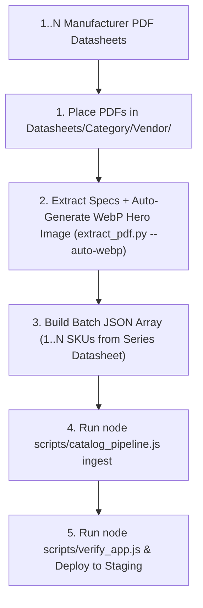

# Universal Hardware Datasheet & Batch Ingestion Pipeline

Use this skill when importing new products, spec sheets, cutsheets, product series families, or device catalogs into NetSelect Enterprise across **any** hardware domain.

This skill ensures deterministic specification extraction, automated hero-image normalization (`assets/images/products/*.webp`), atomic batch upsert into `data/**/*.js`, standard asset linking in `data/data_assets.js`, and 100% compliance with the Design Rule Checker (DRC) and National Codes / Orion Standards.

---

## 1. Supported Hardware Domains & Auto-Routed Target Databases

`scripts/catalog_pipeline.js` automatically routes devices to their target database based on `category`, `role`, and `vendor` (or via explicit `targetFile` / `targetVar` in a batch manifest):

| Category / Domain | Target JavaScript Database | Exported Array / Object |
| :--- | :--- | :--- |
| **Surveillance (Cameras & Video)** | `data/physical_security/data_cameras.js` | `CAMERAS_DATABASE` |
| **Access Control (ACS & Locks)** | `data/physical_security/data_access.js` | `ACCESS_CONTROL_DATABASE` |
| **Networking Switches** | `data/networking/data_<vendor>.js` | `UNIFI_SWITCHES`, `CISCO_SWITCHES`, `MERAKI_SWITCHES`, `JUNIPER_SWITCHES`, `RUCKUS_SWITCHES`, `AMG_SWITCHES`, `ALLIED_SWITCHES` |
| **Firewalls & Security Appliances** | `data/networking/data_firewalls.js` | `FIREWALL_DATABASE` |
| **Wireless PtP / PtMP Bridges** | `data/networking/data_wireless.js` | `WIRELESS_DATABASE` |
| **Compute (NVRs, Servers, Workstations)** | `data/compute_storage/data_servers.js` | `SERVERS_DATABASE`, `WORKSTATIONS_DATABASE` |
| **Power (UPS, EBP, PDU, Power Cords & Cards)** | `data/infrastructure/data_ups_pdu.js` | `UPS_PDU_DATABASE` |
| **Racks, NEMA Enclosures, Cabinets & Mounts** | `data/infrastructure/data_racks_mounts.js` | `RACKS_MOUNTS_DATABASE` |
| **Media Converters, PoE Injectors & Surge** | `data/infrastructure/data_media_poe.js` | `MEDIA_POE_DATABASE` |
| **Structured Cabling** | `data/infrastructure/data_cabling.js` | `CABLING_CATALOG` |

---

## 2. Fast Batch Ingestion Workflow (Recommended)



### Step 1: Audit Unlinked PDFs & Coverage (Optional)
To see which PDFs in `Datasheets/` are not yet linked in `CATALOG_ASSETS` or which catalog devices are missing datasheets/images:
```powershell
node scripts/catalog_pipeline.js audit
```
To automatically sync inline `datasheetPath`/`image` properties and match existing SKUs to PDFs/WebPs on disk:
```powershell
node scripts/catalog_pipeline.js auto-link --apply
```

### Step 2: Extract Text & Auto-Generate Transparent WebP Hero Photo
Extract text and automatically filter/rank embedded raster images (ignoring tiny vendor logos/icons) to convert the top-ranked product photo directly into a 600×600 transparent WebP (`assets/images/products/<device_id>.webp`):
```powershell
python .agents/skills/catalog-datasheet-ingestion/scripts/extract_pdf.py "Datasheets/Cameras/Axis/Axis P3265-LVE - Datasheet.pdf" --auto-webp "axis-p3265-lve"
```
*Batch Folder Extraction*: Pass a directory path to extract text and hero image candidates for an entire folder of PDFs at once:
```powershell
python .agents/skills/catalog-datasheet-ingestion/scripts/extract_pdf.py "Datasheets/Network/AMG" --extract-images --json > scratch/amg_extracted.json
```

### Step 3: Build Single or Multi-SKU Batch JSON Manifest
When a datasheet covers a **product family / series** (e.g., 4–12 SKUs in one PDF), put all SKUs into a single JSON array (`scratch/batch_ingest.json`) instead of importing them one by one.

#### Critical DRC & Code Tags Checklist:
* [ ] **PoE Delivery Class** (`poeStandard`): Must be `"802.3af"`, `"802.3at"`, or `"802.3bt"`.
* [ ] **Nominal vs Peak Watts** (`powerConsumptionWatts` vs `maxPowerWatts`): Always extract peak draw (IR heaters, PTZ motors) to ensure switch PoE budgets don't overcommit.
* [ ] **Outdoor / Environmental Rating** (`outdoor` & `ipRating`): If outdoor and >30W, flag for **802.3bt Surge Protector** (DRC Rule 12). If outdoor, flag for **Cat6A OSP Gel-Filled Cable** (DRC Rule 9).
* [ ] **Access Control Security Level** (`securityLevel`): Set to `1` (Public), `2` (Restricted), or `3` (SCIF/Vault). **Never assign a maglock to Level 3** (DRC Rule 11 / NFPA 101 violation).
* [ ] **Lock Mechanism** (`lockType` & `failSecure`): Must explicitly declare `fail_secure_mortise`, `fail_secure_strike`, or `maglock`.
* [ ] **Dual Power Supply** (`dualPowerSupply`): For switches, routers, and servers, set to `true` if redundant PSUs are present (DRC Rule 14 mandates A/B dual feeds).
* [ ] **Uplink Speeds** (`uplinkSpeed`): For 10G+ copper ports, Orion Standards mandate Cat6A (Cat6 prohibited per DRC Rule 13).

### Step 4: Atomic Batch Validation, Database Upsert & `CATALOG_ASSETS` Registration
Run `scripts/catalog_pipeline.js ingest` on your JSON file. In a single command—without needing to read or manually edit 300KB+ JavaScript catalog files—it:
1. Validates every item against domain schemas, DRC rules, and `CatalogRegistry` duplicate IDs/SKUs.
2. Appends the items into the appropriate `data/**/*.js` array(s).
3. Registers both `id`, `sku`, and any `altKeys` in `data/data_assets.js` (`CATALOG_ASSETS`) in alphabetical order.

```powershell
# Preview with --dry-run first, then apply:
node scripts/catalog_pipeline.js ingest scratch/batch_ingest.json --dry-run
node scripts/catalog_pipeline.js ingest scratch/batch_ingest.json
```

### Step 5: Verify & Deploy to Staging
Run the full pre-deploy verification suite and push to `staging` per `.agents/rules/deployment.md`:
```powershell
node scripts/verify_app.js
```

---

## 3. Standalone Helper Scripts Reference

- **`scripts/catalog_pipeline.js`** (`npm run catalog:audit`, `npm run catalog:link`, `npm run catalog:validate`, `npm run catalog:ingest`):
  - Unified Node.js CLI for catalog auditing, auto-linking, DRC validation, and batch JS database upsert.
- **`.agents/skills/catalog-datasheet-ingestion/scripts/extract_pdf.py`**:
  - Extracts PDF text, metadata, and scored hero-image candidates; supports `--auto-webp <device_id>` and directory batch mode.
- **`.agents/skills/catalog-datasheet-ingestion/scripts/process_image.py`**:
  - Normalizes standalone PNG/JPG product photos into centered 600×600 transparent WebP (`assets/images/products/<id>.webp`).
- **`.agents/skills/catalog-datasheet-ingestion/scripts/register_asset.py`**:
  - Registers single keys or `--batch <json>` manifests into `data/data_assets.js`.
- **`.agents/skills/catalog-datasheet-ingestion/scripts/validate_entry.py`**:
  - Validates single JSON objects or batch JSON arrays against DRC rules and disk assets.
