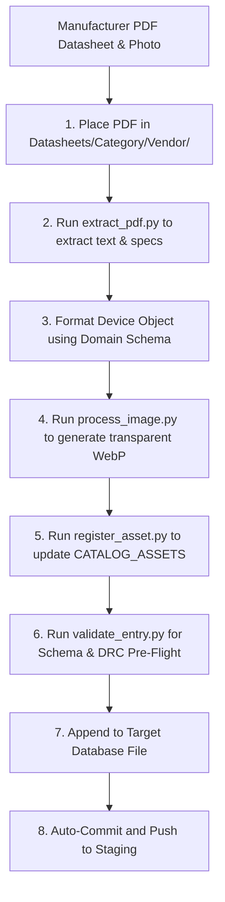

# Universal Hardware Datasheet Ingestion Pipeline

Use this skill when importing new products, spec sheets, cutsheets, or device catalogs into NetSelect Enterprise across **any** hardware domain.

This skill ensures deterministic specification extraction, standard asset linking in `data/data_assets.js`, product photography normalization (`assets/images/products/*.webp`), and 100% compliance with the Design Rule Checker (DRC) and National Codes / Orion Standards.

---

## 1. Supported Hardware Domains & Target Databases

Category / Domain | Target JavaScript Database | Example Devices
:--- | :--- | :---
**Surveillance (Cameras & Video)** | `data/physical_security/data_cameras.js` | Fixed Domes, Bullets, PTZs, 360 Fisheye, Multi-Sensor, Thermals
**Access Control (ACS & Locks)** | `data/physical_security/data_access.js` | Intelligent Controllers, Sub-controllers, Card Readers, Electric Strikes, Mortise Locks, Maglocks, Trove Subplates
**Networking (Switches & Routers)** | `data/networking/data_<vendor>.js` or `data_wireless.js` | Access Switches, Aggregation/Core, Routers, Firewalls, Wireless PtP/PtMP Bridges
**Power & Infrastructure** | `data/infrastructure/data_accessories.js` or `data/registry.js` | 2-Post/4-Post Racks, Wall Cabinets, NEMA 4X Enclosures, 120V/208V UPS, External Battery Packs (EBP), Metered/Switched PDUs
**Structured Cabling** | `data/infrastructure/data_cabling.js` | Bulk Spools (CMP, CMR, CMX, OSP Gel-Filled), Cat6, Cat6A, OS2/OM4 Fiber, Modular Patch Panels
**Hardware Accessories & Mounts** | `data/infrastructure/data_accessories.js` | 802.3bt Surge Protectors, Camera Wall/Pole Brackets, Building Entrance Terminals (BET), PoE Injectors

---

## 2. Ingestion Workflow (Step-by-Step)



### Step 1: Place Datasheet PDF in Standard Directory
Place the PDF under the corresponding category and vendor subfolder:
- `Datasheets/Cameras/<Vendor>/<Model> - Datasheet.pdf`
- `Datasheets/Access Control/<Vendor>/<Model> - Datasheet.pdf`
- `Datasheets/Network/<Vendor>/<Model> - Tech Specs.pdf`
- `Datasheets/Infrastructure/<Vendor>/<Model> - Datasheet.pdf`

### Step 2: Extract Text and Specs from PDF
Run the bundled extraction script to retrieve clean text and technical tables from the PDF:
```powershell
python .agents/skills/catalog-datasheet-ingestion/scripts/extract_pdf.py "Datasheets/Cameras/Axis/Axis P3265-LVE - Datasheet.pdf"
```
*Tip: To extract raster product photos embedded inside the PDF, append `--extract-images --out-dir scratch/extracted_images/`.*

### Step 3: Map Technical Specifications to Domain Schema
Review the extracted text and map fields according to the domain JSON schemas in `schemas/`:
- [`schemas/camera_schema.json`](./schemas/camera_schema.json)
- [`schemas/access_control_schema.json`](./schemas/access_control_schema.json)
- [`schemas/networking_schema.json`](./schemas/networking_schema.json)
- [`schemas/power_infra_schema.json`](./schemas/power_infra_schema.json)
- [`schemas/cabling_accessory_schema.json`](./schemas/cabling_accessory_schema.json)

#### Critical DRC & Code Tags Checklist:
* [ ] **PoE Delivery Class** (`poeStandard`): Must be `"802.3af"`, `"802.3at"`, or `"802.3bt"`.
* [ ] **Nominal vs Peak Watts** (`powerConsumptionWatts` vs `maxPowerWatts`): Always extract peak draw (IR heaters, PTZ motors) to ensure switch PoE budgets don't overcommit.
* [ ] **Outdoor / Environmental Rating** (`outdoor` & `ipRating`): If outdoor and >30W, flag for **802.3bt Surge Protector** (DRC Rule 12). If outdoor, flag for **Cat6A OSP Gel-Filled Cable** (DRC Rule 9).
* [ ] **Access Control Security Level** (`securityLevel`): Set to `1` (Public), `2` (Restricted), or `3` (SCIF/Vault). **Never assign a maglock to Level 3** (DRC Rule 11 / NFPA 101 violation).
* [ ] **Lock Mechanism** (`lockType` & `failSecure`): Must explicitly declare `fail_secure_mortise`, `fail_secure_strike`, or `maglock`.
* [ ] **Dual Power Supply** (`dualPowerSupply`): For switches, routers, and servers, set to `true` if redundant PSUs are present (DRC Rule 14 mandates A/B dual feeds).
* [ ] **Uplink Speeds** (`uplinkSpeed`): For 10G+ copper ports, Orion Standards mandate Cat6A (Cat6 prohibited per DRC Rule 13).

### Step 4: Normalize & Optimize Product Photo
Process the manufacturer photo (PNG, JPG, or extracted PDF rendering) into a standard, centered, square 600x600 transparent WebP:
```powershell
python .agents/skills/catalog-datasheet-ingestion/scripts/process_image.py "path/to/raw_photo.png" "<device_id>" --transparent-bg --size 600
```
*Output: `assets/images/products/<device_id>.webp`*

### Step 5: Register in `CATALOG_ASSETS` (`data/data_assets.js`)
Link the new device ID and SKU to its local PDF and WebP image:
```powershell
python .agents/skills/catalog-datasheet-ingestion/scripts/register_asset.py "<device_id>" "Datasheets/<Category>/<Vendor>/<Model> - Datasheet.pdf" "assets/images/products/<device_id>.webp" --alt-key "<orderable_sku>"
```

### Step 6: DRC & Schema Pre-Flight Validation
Validate that the structured device entry satisfies all schema rules and DRC constraints:
```powershell
python .agents/skills/catalog-datasheet-ingestion/scripts/validate_entry.py "scratch/candidate_entry.json"
```

### Step 7: Append to Target Database File
Append the validated JavaScript object into the array in the appropriate file (e.g. `CAMERAS_DATABASE` in `data_cameras.js`, `ACCESS_CONTROL_DATABASE` in `data_access.js`, etc.).

### Step 8: Automatic Staging Deployment
Per `.agents/rules/deployment.md`, commit the new hardware and assets to the feature branch, merge into `staging`, and push to trigger the Azure Static Web Apps build:
```powershell
git add .
git commit -m "feat(catalog): ingest <Vendor> <Model> with datasheet linking and DRC tags"
git push origin feature/modular-architecture
git checkout staging
git merge feature/modular-architecture -m "chore(staging): merge <Vendor> <Model> catalog ingestion"
git push origin staging
git checkout feature/modular-architecture
```

---

## 3. Reference JSON Snippets by Domain

### Camera Example (`data_cameras.js`)
```javascript
{
  id: "axis-q3538-lve-4k-dome",
  vendor: "Axis Communications",
  model: "Axis Q3538-LVE 4K AI Dome Camera",
  sku: "02131-001",
  role: "Camera",
  category: "cameras",
  formFactor: "Dome (Ultra High-Res)",
  resolution: "4K (8MP @ 60fps)",
  sensorMegapixels: 8,
  compression: "H.265 / H.264 / Zipstream",
  streamBitrateMbps: 8.5,
  poeStandard: "802.3at",
  poeClass: "Class 4",
  powerConsumptionWatts: 14.2,
  maxPowerWatts: 25.5,
  irIllumination: true,
  irRangeMeters: 50,
  lensType: "Varifocal 4.3-8.6mm i-CS Lens",
  fieldOfViewDeg: 103,
  ipRating: "IP66 / IP67 / NEMA 4X",
  ikRating: "IK10+ Vandal-Proof",
  outdoor: true,
  operatingTempMinC: -50,
  operatingTempMaxC: 60,
  weightLbs: 4.4,
  msrp: 1499,
  taa: true,
  deepLearningAnalytics: true,
  keyFeatures: [
    "Lightfinder 2.0 and Forensic WDR with 4K resolution at up to 60 fps",
    "Deep learning processing unit (DLPU) powering advanced metadata object analytics",
    "OptimizedIR up to 50 meters (164 ft) in complete darkness",
    "Extreme weather and vandal protection with IP66, IP67, NEMA 4X, and IK10+ ratings"
  ]
}
```

### Access Control Example (`data_access.js`)
```javascript
{
  id: "hes-9600-strike",
  vendor: "HES / ASSA ABLOY",
  model: "HES 9600 Series Heavy-Duty Surface Electric Strike",
  sku: "9600-630-12/24D",
  role: "Lock Hardware",
  category: "access_control",
  hardwareSubtype: "electric_strike",
  securityLevel: 3,
  lockType: "fail_secure_strike",
  failSecure: true,
  powerSource: "external_dc",
  voltageVdc: "12/24VDC Field Selectable",
  powerConsumptionWatts: 5.5,
  holdingForceLbs: 2000,
  mounting: "Surface-Mounted Rim Exit Device",
  msrp: 485,
  taa: true,
  keyFeatures: [
    "Windstorm and fire-rated heavy-duty stainless steel electric strike (ANSI/BHMA A156.31 Grade 1)",
    "Fail-secure configuration maintains perimeter integrity during power outage and fire alarm activation",
    "2,000 lbs static holding force for high-security Level 3 vault and SCIF openings"
  ]
}
```

### Switch Example (`data_juniper.js`)
```javascript
{
  id: "juniper-ex4100-24p",
  vendor: "Juniper Networks",
  model: "Juniper EX4100 24-Port PoE+ Gigabit Ethernet Switch",
  sku: "EX4100-24P",
  role: "Access",
  category: "networking",
  ports: 24,
  poeBudget: 740,
  poeStandard: "802.3at",
  poeMaxPortWatts: 30,
  uplinkPorts: 4,
  uplinkSpeed: "10G SFP+",
  dualPowerSupply: true,
  stackingSupported: true,
  maxStackUnits: 10,
  throughputGbps: 168,
  msrp: 4200,
  taa: true,
  keyFeatures: [
    "24x 10/100/1000BASE-T PoE+ ports delivering up to 740W total PoE budget",
    "4x 1/10GbE SFP/SFP+ uplink ports and 2x 40GbE Virtual Chassis stacking ports",
    "Dual redundant hot-swappable AC power supplies supporting Circuit A/B feeds",
    "Cloud-ready switch powered by Mist AI for automated operations and telemetry"
  ]
}
```
